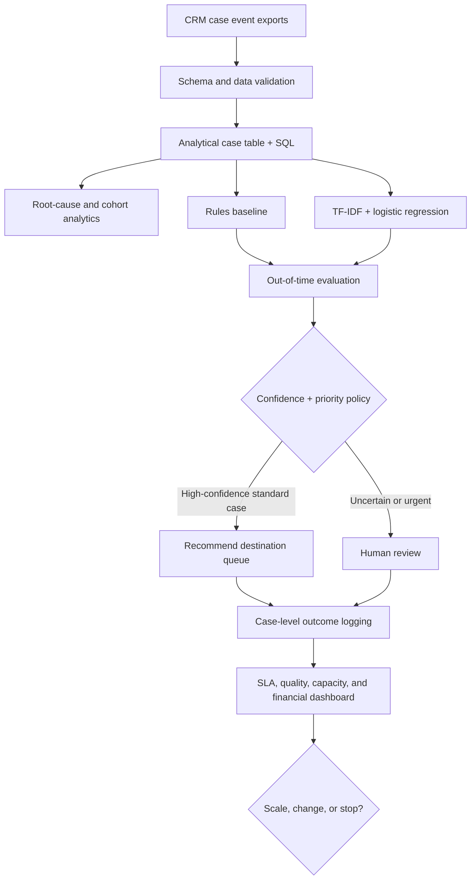

# CaseFlow AI — Service Operations Decision Optimization

> **Educational portfolio prototype. All 15,300 service cases are synthetic.** This is not evidence of work performed at Globe Infotech or any other employer, and the financial results are **modeled capacity values**, not bankable savings.

## The business problem

A hypothetical B2B services business receives 900 requests/month across billing, access, technical, account, and fulfillment functions. Manual categorization, missing information, wrong routing, and uneven queues drive delay. The business wants to reduce cycle time and total cost **without increasing routing mistakes or violating service-level commitments**.

## Decision to be made

1. Should the organization stay manual, standardize intake/rules, or pilot AI-supported classification?
2. If AI is used, what confidence threshold provides worthwhile coverage while meeting the `>=97%` routed-precision guardrail?
3. Does the investment yield positive net business value after QA, error costs, implementation, and ongoing operation?
4. What evidence would justify scaling a pilot?

## Run the working proof of concept

```bash
python -m venv .venv
source .venv/bin/activate            # Windows: .venv\Scripts\activate
pip install -r requirements.txt
python src/caseflow.py
python -m pytest -q tests/
streamlit run app.py
```

No API keys or internet access are required to generate the data, train the model, score the test data, or run the dashboard after dependencies are installed.

### What is genuinely implemented

- Deterministic synthetic case generation with timestamps, unstructured descriptions, missing fields, first-route errors, case handling times, waiting times, and SLA outcomes
- Temporal train/validation/test split, preventing random-split time leakage
- Rules-based baseline and TF-IDF + logistic regression model
- Precision-constrained validation threshold selection, human review for high/critical priority tickets, abstention on low-confidence cases
- Out-of-time test evaluation, confusion-aware false-route rate, selective coverage, monthly released-capacity and Year-1 business case
- Root-cause SQL queries, unit tests, outputs, charts, interactive Streamlit dashboard
- Excel financial sensitivity model with input cells and formulas

### What is **not** implemented (proposed production extensions)

- Production CRM API integration, governed employee review UI, live message queue, LLM-based classification, OR-Tools capacity optimizer, MLflow registry, Evidently monitoring, Prefect orchestrator, actual randomized field experiment, privacy/legal review, or deployment to real customer data

## Architecture



## Model design

- Label: correct destination queue, as assigned at case resolution (not the initial routing guess)
- Inputs at decision time: case text and its priority flag, not resolution fields
- Baseline: transparent keyword-based rules
- Model: `TfidfVectorizer(1,2-grams)` + multinomial-capable `LogisticRegression` classification
- Split: Jan–Dec 2023 training; Jan–Feb 2024 validation; Mar–May 2024 held-out test
- Decision: highest predicted class only if probability exceeds validation-selected threshold and priority is Standard; otherwise human review
- Threshold constraint: `>=97%` validation precision among routed cases and `>=25%` automation coverage
- Ranking objective within feasible candidates: maximize assumed minutes saved per incoming case (penalize review and misroutes)
- Report both model **full-coverage accuracy** and policy **coverage and selective precision**; one is not a substitute for the other
- `predict_proba` confidence is a model estimate; probability calibration should be separately tested on genuine, heterogeneous data before production

## Operational analysis

1. Profile case arrival volume by month, category, priority and channel.
2. Measure missing-field and first-route error rates, and handling/SLA outcomes by group.
3. Determine whether source/process issues or model errors are the primary constraints.
4. Compare `manual -> rule-assisted -> model-assisted` on multiple metrics, not just accuracy.
5. Use actual pilot logs to estimate *causal* time savings: prediction of a classification label alone does not prove process efficiency.

## Financial calculation

`Hours released per month = monthly cases × [policy coverage × (minutes saved - QA minutes) - all-case wrong-route rate × error penalty] / 60`

`Annual capacity value = released monthly hours × labor rate × 12`

`Year-1 modeled value = annual capacity value - one-time implementation - annual running expense`

**Never equate released staff capacity to realized cash savings** without showing avoided overtime, vendor spend, or a changed staffing budget.

## Guardrails

- High and critical priority tickets always go to human review in the prototype.
- Escalate low-confidence, unfamiliar, sensitive, or ambiguous requests.
- Test subgroup performance by category, channel, and workload period.
- Track precision/coverage curves and monitor text/label drift over time.
- Review customer/employee privacy, retention policy, security, audit logs, and error recovery before deployment.
- Maintain rollback to manual or rules-only operation.

## What a real-life pilot requires

- 4–6 weeks of pre-period case-event instrumentation and workflow mapping
- Randomized assignment of eligible service cases (or time-block cluster randomization if contamination is a concern)
- Primary outcome: time per resolved case including rework and QA; companion outcome: SLA breach rate
- Quality guardrails: misroutes, reopened tickets, customer satisfaction, escalation delays
- Pre-register sample size using actual baseline variance and minimum worthwhile improvement
- Calculate labor capacity + incident cost in line with Finance, then compare to implementation/running cost

## Contents

- `src/caseflow.py`: synthetic generator, decision model, validation, financial logic
- `sql/root_cause.sql`: SQL analyses to investigate operational bottlenecks
- `app.py`: interactive executive dashboard
- `data/synthetic_cases.csv`, `data/caseflow.db`: synthetic raw and SQL-friendly datasets
- `outputs/metrics.json`: reproducible KPI and model scorecard
- `outputs/validation_thresholds.csv`: threshold trade-off and risk constraints
- `outputs/out_of_time_predictions.csv`: case-level held-out predictions and abstentions
- `outputs/CaseFlow_Economics.xlsx`: editable scenario spreadsheet
- `docs/EXECUTIVE_DECISION_MEMO.md`: evidence-based recommendation
- `docs/DATA_DICTIONARY.md`: definitions, measurement windows, caveats
- `tests/test_caseflow.py`: tests covering model guardrails and economics

## Questions a strong interviewer will ask

1. Why prioritize misrouting instead of increasing staffing? What alternative hypotheses were rejected?
2. Why use thresholded classification instead of a state-of-the-art language model?
3. How does routing precision change when automation coverage rises?
4. What does the financial model count as **incremental** benefit? Which costs are missing?
5. What would invalidate this model after deployment?
6. How could a rise in handle time reflect an inflow of more difficult cases rather than a failed intervention?
7. How would you separate operational effects from seasonality and staffing changes?

*Note: the model is trained on intentionally simplified, labeled synthetic text. Performance is likely optimistic relative to real CRM tickets. Evaluations do not justify live deployment.*
